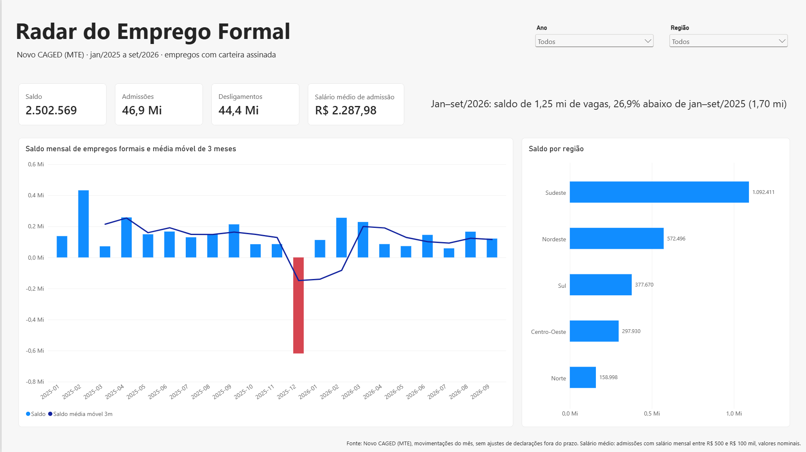

# Radar do Emprego Formal

Painel em Power BI sobre o mercado de trabalho formal brasileiro, construído com os microdados do **Novo CAGED** (Ministério do Trabalho e Emprego), de janeiro de 2025 a setembro de 2026.



## O que o painel mostra

Em jan–set/2026 o Brasil criou **1,25 milhão de vagas formais** (saldo = admissões − desligamentos). É um resultado positivo, mas **26,9% menor** que o do mesmo período de 2025 (1,70 milhão): o emprego formal segue crescendo, em ritmo mais lento.

O painel tem quatro páginas:

| Página | Pergunta que responde |
|---|---|
| **Visão Geral** | Quantas vagas foram criadas, mês a mês, e como o ritmo evoluiu? |
| **Onde** | Quais estados criam mais vagas e quais pagam melhor? |
| **Quem** | Quem está sendo contratado (idade, escolaridade, sexo) e quanto recebe? |
| **O quê** | Quais setores e ocupações geram vagas? Como está o recorte de TI e dados? |

### Alguns achados (jan/2025 a set/2026)

- A criação de vagas se concentra em **jovens de 18 a 24 anos** (cerca de 73% do saldo do período) e em quem tem **ensino médio completo** (cerca de 78%).
- Por região, o **Sudeste** lidera em saldo (1,09 mi), seguido por Nordeste (572 mil) e Sul (378 mil).
- Os setores com maior saldo são **Atividades administrativas**, **Construção** e **Indústrias de transformação**.
- O salário médio de admissão sobe com a escolaridade: cerca de R$ 2.057 (médio completo), R$ 4.225 (superior completo) e R$ 7.494 (pós-graduação).
- Em **TI e dados**, o salário médio de admissão (R$ 6.486) é quase três vezes o das demais ocupações (R$ 2.245), mas o saldo de vagas é pequeno (22,9 mil) e varia bastante entre as famílias de ocupação.
- Entre mulheres e homens, o salário médio de admissão das mulheres é cerca de 10% menor (R$ 2.149 contra R$ 2.394). É uma diferença bruta, sem controle por setor, ocupação ou escolaridade.
- Dezembro de 2025 teve saldo negativo (−618 mil), padrão sazonal de fim de ano.

## Estrutura do repositório

```
radar-emprego-formal/
├── dados_tratados/   tabelas prontas para o Power BI (fatos em Parquet, dimensões em CSV)
├── notebooks/        01_tratamento_dados.ipynb: download, tratamento e consolidação (Google Colab)
├── powerbi/          radar_emprego_formal.pbix
├── docs/             PDF e imagens do painel
└── README.md
```

## Como foi construído

1. **Coleta e tratamento (Python, Google Colab).** O notebook baixa cada mês do arquivo `CAGEDMOV` no servidor do MTE, agrega os microdados (cerca de 4,4 milhões de linhas por mês) e salva tabelas pequenas em Parquet. São 21 competências, de 2025-01 a 2026-09.
2. **Modelo (Power BI).** Esquema estrela com duas tabelas fato e dimensões de calendário, UF, setor, escolaridade, sexo, faixa etária e família de ocupação. São 9 relacionamentos, todos muitos-para-um e com filtro em uma direção.
3. **Medidas (DAX).** Admissões, desligamentos, saldo, salário médio de admissão, variação contra o mês anterior e contra o mesmo mês do ano anterior, saldo acumulado no ano, média móvel de 3 meses e ranking de UFs.
4. **Painel.** Quatro páginas em tela Full HD (1920×1080), com filtros de ano e região sincronizados entre as páginas.

### Modelo de dados

| Tabela | Conteúdo |
|---|---|
| `fato_emprego` | Admissões, desligamentos, quantidade e soma de salários por mês, UF, setor, escolaridade, sexo e faixa etária |
| `fato_ocupacao` | As mesmas medidas por mês, UF e família de ocupação (CBO). Não tem coluna de setor |
| `dim_calendario` | Calendário diário criado em DAX, de jan/2025 até o último mês com dados |
| `dim_uf`, `dim_secao`, `dim_escolaridade`, `dim_sexo`, `dim_faixa_etaria`, `dim_cbo_familia` | Descrições, agrupamentos e ordenação |

## Decisões de tratamento

Estas decisões afetam os números. Estão registradas aqui para que qualquer pessoa possa conferir e refazer.

- **Só movimentações do mês (`CAGEDMOV`).** O painel não usa os arquivos de movimentações fora do prazo (`CAGEDFOR`) nem de exclusões (`CAGEDEXC`). Por isso o saldo de cada mês bate com o divulgado no dia do lançamento, mas a soma dos meses **não coincide** com o acumulado oficial, que incorpora ajustes e declarações atrasadas:

  | Período | Soma dos saldos mensais (este painel) | Acumulado oficial divulgado |
  |---|---|---|
  | 2025 | 1.256.997 | 1.279.498 |
  | Jan–set/2026 | 1.245.572 | 1.248.914 |

- **Saldo = admissões − desligamentos**, a partir da coluna `saldomovimentação` (+1 admissão, −1 desligamento).
- **Salário médio de admissão.** Considera apenas admissões com unidade de salário **mensal** (código 5) e valor entre **R$ 500 e R$ 100.000**. Isso exclui salários por hora, dia, tarefa ou variável (que não são comparáveis), zeros e valores claramente digitados errado. A média é calculada como soma dos salários ÷ quantidade de salários válidos, para continuar correta em qualquer filtro. Entre 89,6% e 92,6% das admissões de cada mês entram nesse cálculo.
- **Valores nominais.** Os salários não foram corrigidos pela inflação.
- **Faixas etárias:** até 17, 18–24, 25–29, 30–39, 40–49, 50–64, 65 ou mais e "não informada".
- **Escolaridade agrupada** em sete grupos (fundamental incompleto até pós-graduação) para facilitar a leitura.
- **Famílias de ocupação (CBO).** A análise por ocupação usa os 4 primeiros dígitos da CBO. Duas famílias (3227 e 5169) aparecem nos microdados, mas não existem no layout oficial; foram incluídas na dimensão e classificadas pelo grande grupo. Os nomes das ocupações vêm sem acento, como no layout do MTE.
- **Recorte "TI e dados".** É uma aproximação por famílias da CBO: 1236, 1425, 2112, 2122, 2123, 2124, 3171 e 3172 (diretores e gerentes de TI, estatísticos, engenheiros, analistas e administradores de sistemas e bancos de dados, programadores e operadores). Não há uma ocupação "cientista de dados" separada nessa classificação, então o recorte não captura todo o mercado de dados.
- **UF e setor não identificados** aparecem como "NI" ou "Não identificado" e foram excluídos dos gráficos por UF e dos rankings.

## Validação

Os saldos mensais foram conferidos contra os números divulgados pelo MTE no lançamento de cada competência (por exemplo, jan/2025: 2.271.611 admissões, 2.134.308 desligamentos, saldo de +137.303; ago/2026: 2.294.563 admissões, 2.128.736 desligamentos, saldo de +165.827). Também foi verificado que `fato_emprego` e `fato_ocupacao` têm exatamente as mesmas admissões e desligamentos em todos os meses, e que não há chaves duplicadas.

## Limitações

- O saldo mede **criação líquida de vagas formais**, não desemprego nem o total de pessoas ocupadas (não inclui informalidade, conta própria nem servidores estatutários).
- Os dados mais recentes podem ser revisados pelo MTE em divulgações posteriores.
- Comparações entre grupos (por exemplo, salário de mulheres e homens) são diferenças brutas e não indicam causa.
- O recorte de TI e dados é uma aproximação, como descrito acima.

## Como reproduzir

1. Abra `notebooks/01_tratamento_dados.ipynb` no Google Colab e execute as células em ordem (monta o Google Drive, baixa os 21 meses e gera `dados_tratados/`). O processamento leva cerca de 35 a 40 minutos, em média cerca de 100 segundos por mês.
2. Abra `powerbi/radar_emprego_formal.pbix` no Power BI Desktop.
3. Em **Transformar dados → Configurações da fonte de dados**, aponte as consultas para a pasta `dados_tratados/` do seu computador e clique em **Atualizar**.

## Fonte

Ministério do Trabalho e Emprego (MTE), Programa de Disseminação das Estatísticas do Trabalho (PDET): microdados do Novo CAGED, arquivos `CAGEDMOV`.

## Autora

**Patrícia Falchi**. Formação em Direito, em transição de carreira para análise de dados.
[LinkedIn](https://www.linkedin.com/in/patricia-falchi/)
